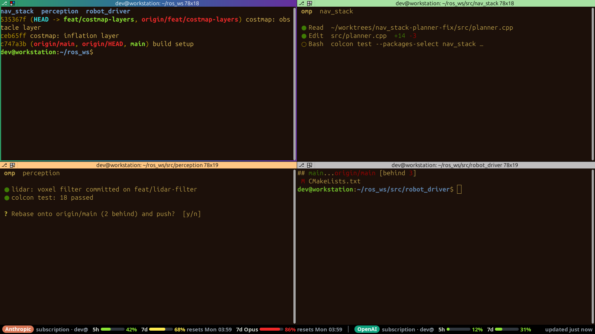
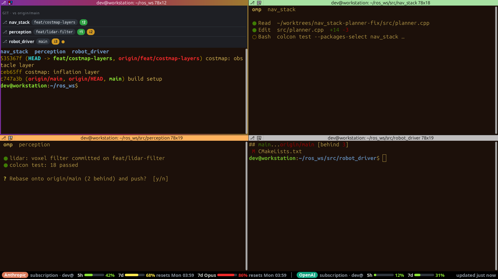
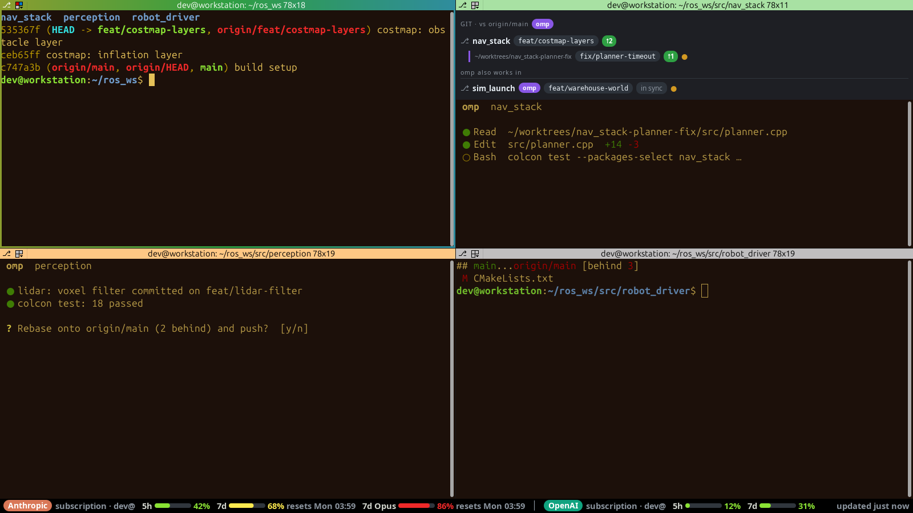
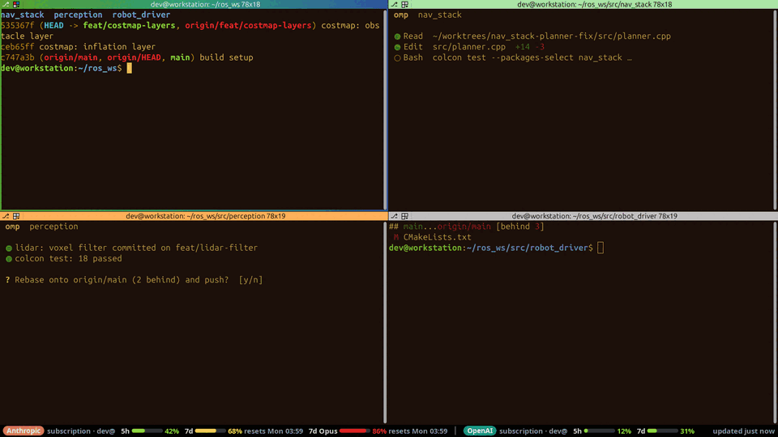

# ai-glance

A Terminator 2.1.3 plugin for working with AI coding agents (omp) across git worktrees.

- **Git button** (⎇) at the far left of every pane's title bar. Click it to open a panel
  inside that pane (no split) showing the checked-out branch, ahead/behind vs
  `origin/main` and uncommitted changes. In a ROS workspace root (e.g. `~/ros_ws`) it shows
  one row per repo under `src/`. When omp or Claude Code runs in the pane, the worktrees
  that session is working in are listed too (only those): everything it touched in the
  15 minutes before its latest file/directory access, so an idle session waiting for input
  still shows its worktrees. Repos the session works in outside the pane's folder are listed
  under "<agent> also works in" (up to 6). Outside a repo: "Not a git repository".
- **Usage bar** at the bottom of every window: provider, plan type and every limit window
  with a level bar, green below 60 %, yellow 60–79 %, red from 80 %. Refreshed every
  60 s ("n/a" when unavailable).
- **Active pane**: animated colour gradient on its header and a 3 px frame in the same
  gradient (stock colours while broadcasting).
- **Unfocused panes running omp or Claude Code**: pastel green header while the agent is
  working (turn running, tool in flight, subagents/background agents running), pulsing
  orange while it waits for your input (turn over, `ask` or permission prompt open).
  Panes without an agent keep the stock header.

## Screenshots

> **Note:** the terminal background and text colours (dark brown `#1c100a`, amber
> `#e5c158`) and the font (Ubuntu Sans Mono 13) come from my own custom Terminator
> profile, not Terminator's defaults. Header colours, git panel and usage bar are the
> plugin's and look the same with any profile.

Four panes: the active one (top left, `~/ros_ws`) with the animated gradient header and
frame, omp working in the top right (green header), omp waiting for input in the bottom
left (orange, pulsing), a plain shell in the bottom right (stock header). Usage bar at the
bottom.

Git panel opened with ⎇ in the workspace root: one card per repo under `src/`, with
branch, ahead (↑) / behind (↓) vs `origin/main` and a dot for uncommitted changes.

Git panel in a pane running omp: the linked worktree omp edits is listed under its repo,
and a repo outside the pane's folder appears under "omp also works in".

Behaviour over 9 s: gradient cycling on the active header, orange pulse on the waiting
pane, the panel opening and closing, focus moving to the bottom right pane (the gradient
follows it, the old pane drops back to the stock header).

Repos, usage numbers and agent output are demo data. Regenerate with
`xvfb-run -a -s '-screen 0 1600x900x24' python3 tools/make_screenshots.py` (real
Terminator + plugin in a throwaway HOME, your Terminator config copied for the colours;
agent state and usage are faked, nothing touches `~/.config`, omp or the network).

## Install / uninstall

    bash install.sh              # symlinks into ~/.config/terminator/plugins, enables AiGlance
    bash install.sh --uninstall  # removes the symlinks and the AiGlance entry

Only the `enabled_plugins` line in `[global_config]` is edited (comments and other keys are
kept). Whenever that line has to change, the previous config is first copied to
`~/.config/terminator/config.bak-ai-glance` (overwriting an older backup), and the file is
re-read afterwards; the script exits non-zero if the result is not as intended. A re-run
that has nothing to change touches neither the config nor the backup.
**Restart Terminator after installing or uninstalling**; open windows are not changed
until then. Terminator's title bars must be on (the
`show_titlebar` option, on by default), otherwise there is no place for the git button.

## Risk: monkeypatching

Terminator has no plugin API for title-bar widgets or window chrome, so the plugin patches
`terminatorlib` classes at runtime (Titlebar, Window). Nothing under `terminatorlib` is
modified on disk, patches are applied once and are idempotent, and failures are logged
rather than raised, but a Terminator update that changes those internals can silently
disable the button or bar. It was written against Terminator 2.1.3. Disabling the plugin
and restarting returns Terminator to stock behaviour.

## Data sources

- `git` CLI (run in worker threads, never on the GTK main thread).
- `~/.omp/agent/terminal-sessions` and the omp session logs, to find which worktrees an
  omp process on a pane's tty is using and whether it is working or waiting for input.
- `~/.claude/sessions/<pid>.json` (session id and busy/waiting/idle status) and
  `~/.claude/projects/*/<session>.jsonl`, the same for a Claude Code process on a pane's tty.
- `omp usage --json` for live usage limits (omp itself queries the provider), falling back
  to the history in `~/.omp/agent/agent.db`, which is only ever opened **read-only**.

The plugin itself makes no network requests; only `omp usage` talks to the providers.

## Tests

    python3 -m pytest tests -q

The GUI smokes need a real ROS workspace with git repos (some with linked
worktrees) and run under Xvfb with an isolated config:

    export AI_GLANCE_SMOKE_WS=~/ros_ws                       # workspace root
    export AI_GLANCE_SMOKE_REPO=~/ros_ws/src/robot_driver    # a repo inside it
    for s in tests/smoke_*.py; do XDG_CONFIG_HOME=$(mktemp -d) xvfb-run -a python3 "$s"; done

`AI_GLANCE_SMOKE_WORKTREE_WS` optionally points at a worktree workspace
(default `$AI_GLANCE_SMOKE_WS/.worktrees/v2-ws`; skipped if absent).
